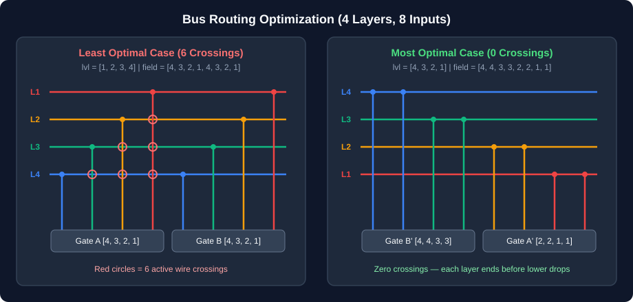

# Bus Routing Optimizer

A lightweight optimizer for bus layer ordering and logic gate block placement (e.g., 7446 BCD-to-7-segment decoder) that minimizes wire crossings using **Simulated Annealing**.

## Technologies

- **Python 3.10+** (standard library only: `random`, `math`, `copy`)
- **SVG** (routing topology visualization)

## How the Algorithm Works

The algorithm solves the combinatorial minimization of wire crossings (*valid cuts*) between horizontal bus layers (`lvl`) and vertical gate input drops (`blocks_gate`):

1. **Structure Flattening (`map_field`):** Expands the nested hierarchy of logic blocks and gates into a 1D sequence vector of input pins.
2. **Fast Cost Evaluation (`valid_cuts_fast`):** Finds the last occurrence index (`last_pos`) for every signal. A crossing occurs whenever a vertical drop from a lower layer intersects a horizontal bus line from an upper layer that has not yet reached its final connection point.
3. **Hierarchical Mutation (`random_swap_hierarchical`):** At each step, the algorithm randomly swaps either two bus layers in `lvl` or two elements at a random nesting depth inside `blocks_gate` (swapping block order, gate order within a block, or pin order within a gate).
4. **Simulated Annealing (`optimize_routing`):** Configurations with fewer crossings are always accepted, while worse configurations are accepted with a decaying Boltzmann probability $\exp(-\Delta / T)$ to escape local minima. A Multi-Start loop runs multiple independent searches to find the global optimum.

## Visualization (4 Layers, 8 Inputs)

The diagram below compares the least optimal arrangement (6 wire crossings) against the fully optimized layout (0 wire crossings):



## Usage

```bash
python main.py
```
